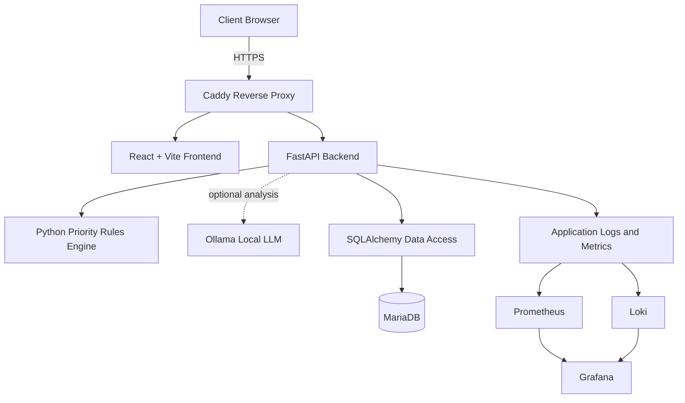
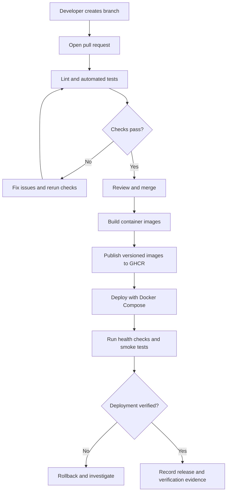

# 911 Call Center Analysis and Cloud-Based Emergency Triage System

|                          |                                                                       |
|--------------------------|-----------------------------------------------------------------------|
| **Course:**              | Cloud Computing, DevOps, and AI | 
| **Team Members**         | -*Sam Stewart*
| **Contact**              | stewartsamaira4@gmail.com 
| **Instructor**           | Gregor von Laszewski |
| **Date**                 | *Sept. 6 2026* |

## Table of Contents

1.  [Project Overview](#1-project-overview)
2.  [Problem Statement](#2-problem-statement)
3.  [Objectives and Success
    Criteria](#3-objectives-and-success-criteria)
4.  [Minimum Viable Product Scope](#4-minimum-viable-product-mvp-scope)
5.  [Technical Approach](#5-technical-approach)
    -   [5.1 Cloud Architecture](#51-cloud-architecture)
    -   [5.2 Open-Source DevOps and Deployment
        Pipeline](#52-open-source-devops-and-deployment-pipeline)
        -   [5.2.1 Source Control](#521-source-control)
        -   [5.2.2 Continuous Integration](#522-continuous-integration)
        -   [5.2.3 Database Testing](#523-database-testing)
        -   [5.2.4 Security Testing](#524-security-testing)
        -   [5.2.5 Docker Build](#525-docker-build)
        -   [5.2.6 Container Image
            Registry](#526-container-image-registry)
        -   [5.2.7 Continuous Deployment](#527-continuous-deployment)
        -   [5.2.8 Docker Compose
            Deployment](#528-docker-compose-deployment)
        -   [5.2.9 Database Deployment](#529-database-deployment)
        -   [5.2.10 Ollama Deployment](#5210-ollama-deployment)
        -   [5.2.11 Monitoring](#5211-monitoring)
        -   [5.2.12 Health Checks](#5212-health-checks)
        -   [5.2.13 Deployment
            Verification](#5213-deployment-verification)
        -   [5.2.14 Rollback Strategy](#5214-rollback-strategy)
        -   [5.2.15 Complete Pipeline](#5215-complete-pipeline)
        -   [5.2.16 Definition of Done](#5216-definition-of-done)
    -   [5.3 Architecture Component
        Description](#53-architecture-component-description)
        -   [5.3.1 MariaDB Database
            Schema](#531-mariadb-database-schema)
        -   [5.3.2 Python Priority Ranking and Triage
            Engine](#532-python-priority-ranking-and-triage-engine)
    -   [5.4 Security, Privacy, and Responsible
        Use](#54-security-privacy-and-responsible-use)
    -    [5.5 Multi-Environment Cloud Strategy: Multipass, Jetstream 2, and Google Cloud Platform](#55-multi-env-cloud-strategy)
6.  [Development Features](#6-development-features)
    -   [6.1 Working Message System](#61-working-message-system)
    -   [6.2 Automated Prioritization](#62-automated-prioritization)
    -   [6.3 Functional Call Center
        Dashboard](#63-functional-call-center-dashboard)
    -   [6.4 Cloud Deployment](#64-cloud-deployment)
    -   [6.5 Final Testing](#65-final-testing)
    -   [6.6 Final Demonstration](#66-final-demonstration)
7.  [Resources and Budget](#7-resources-and-budget)
    -   [7.1 Resource Budget](#71-resource-budget)
8.  [Risk Management](#8-risk-management)
9.  [Deliverables](#9-deliverables)
10. [Database Selection: PostgreSQL
    vs. MariaDB](#10-database-selection-postgresql-vs-mariadb)
    -   [10.1 Database Selection
        Criteria](#101-database-selection-criteria)
    -   [10.2 Why PostgreSQL Was
        Considered](#102-why-postgresql-was-considered)
    -   [10.3 Why MariaDB Is
        Appropriate](#103-why-mariadb-is-appropriate-for-this-project)
    -   [10.4 MariaDB's Role in the
        Architecture](#104-mariadbs-role-in-the-overall-architecture)
    -   [10.5 Limitations and Tradeoffs](#105-limitations-and-tradeoffs)
    -   [10.6 Final Database Decision](#106-final-database-decision)
11. [References](#11-references)

------------------------------------------------------------------------

## 1. Project Overview

This project is a cloud-based application that simulates a
text-to-911 emergency communication service. A user submits a simulated
emergency text message through a web interface. The application sends
the message to a backend API, validates it, stores it in a relational
database, and displays it in an administrative dashboard for authorized
reviewers.

The application will also demonstrate a triage-assistance workflow. A
Python service will evaluate message content using configurable keyword
rules and, where available, an local large language model (LLM)
served by Ollama. The resulting priority is a **suggestion for a human
reviewer**, not a decision to dispatch emergency services. Reviewers can
inspect the original message, see the rationale for a suggested
priority, change the priority, and record their review.

The project is intended for software-engineering education and
demonstration. It will use synthetic messages and will not connect to a
public-safety answering point (PSAP), emergency telephone network, SMS
gateway, or live dispatch system. It is not designed or certified for
operational emergency use.

The implementation emphasizes a consistent, maintainable open-source
stack:

-   **Frontend:** React and Vite.
-   **Backend API:** Python and FastAPI.
-   **Database:** MariaDB.
-   **Data access and migrations:** SQLAlchemy and Alembic.
-   **Triage assistance:** Python rules engine with Ollama
    local LLM analysis.
-   **Deployment:** Docker and Docker Compose.
-   **CI/CD:** GitHub Actions and GitHub Container Registry (GHCR).
-   **Reverse proxy and HTTPS:** Caddy.
-   **Observability:** Prometheus, Grafana, and Loki.

## 2. Problem Statement

Emergency communication environments may receive messages that vary in
urgency, clarity, and completeness. In a real environment, staff need
reliable processes for reviewing incoming communications, identifying
potentially urgent situations, and maintaining an accurate record of
actions taken.

This project does not attempt to solve real-world emergency dispatch.
Instead, it models a limited portion of the workflow so students can
explore how a web application might receive, store, present, and
organize simulated incoming messages. It also demonstrates the
challenges of assisting human decision-makers with rule-based and
language-model-based analysis.

The project focuses on several software-engineering challenges:

1.  Accepting and validating messages through a web application.
2.  Persisting messages and their review history in a relational
    database.
3.  Applying transparent, testable rules to suggest priority levels.
4.  Presenting incoming messages in an administrative dashboard.
5.  Restricting access to administrative functions.
6.  Testing, deploying, monitoring, and documenting a containerized
    application.
7.  Communicating the limitations of automated classification and
    keeping a human reviewer in control.

## 3. Objectives and Success Criteria

The project will be evaluated against functional, technical, and
responsible-use criteria.

```
  -----------------------------------------------------------------------
  Objective                           Success criterion
  ----------------------------------- -----------------------------------
  Message submission                  A user can submit a synthetic
                                      emergency message through the React
                                      interface.

  API validation                      FastAPI validates required fields
                                      and returns useful success or error
                                      responses.

  Data persistence                    Valid messages are stored in
                                      MariaDB and remain available after
                                      an application restart.

  Priority assistance                 The triage engine assigns one of
                                      four suggested levels: Critical,
                                      High, Moderate, or Low.

  Explainability                      A reviewer can see the rule matches
                                      or analysis rationale behind a
                                      suggested level.

  Human oversight                     An authorized reviewer can change
                                      the suggested level and record a
                                      review note.

  Auditability                        Message creation, analysis,
                                      priority changes, and review
                                      actions are recorded.

  Dashboard                           An administrative user can view,
                                      sort, filter, and inspect submitted
                                      messages.

  Automated testing                   Backend, API, database, and core
                                      triage behavior are covered by
                                      automated tests.

  Deployment                          The application can be built and
                                      run through Docker Compose using
                                      documented configuration.

  CI/CD                               GitHub Actions runs checks and
                                      builds versioned container images.

  Security                            Secrets are not committed to source
                                      control; access to administrative
                                      functions is restricted.

  Responsible use                     Only synthetic data is used, and
                                      the interface clearly identifies
                                      classifications as suggestions.
  -----------------------------------------------------------------------
```

The team should record actual test results and deployment evidence
rather than claiming success before the features have been implemented
and verified.

## 4. Minimum Viable Product (MVP) Scope

The MVP will prioritize a complete end-to-end workflow over advanced
integrations.

### In scope

-   React + Vite client interface for submitting synthetic messages.
-   FastAPI endpoints for creating and retrieving messages.
-   MariaDB storage using SQLAlchemy models and Alembic migrations.
-   Four-level priority suggestions using a deterministic Python keyword
    rules engine.
-   Optional Ollama analysis behind a configuration flag or mechanism; the
    application must still work when Ollama is unavailable.
-   Administrative dashboard for viewing, filtering, and reviewing
    messages.
-   Ability for a reviewer to override a suggested priority and record a
    reason.
-   Audit records for important message and review events.
-   Basic authentication and role-based authorization for administrative
    functionality.
-   Docker Compose configuration for local development and
    demonstration.
-   Automated tests and a documented CI workflow.
-   Synthetic seed data and a final demonstration script.

### Out of scope for the MVP

-   Connection to actual emergency services, PSAP systems, telephony, or
    dispatch software.
-   Sending real SMS messages or accepting live emergency
    communications.
-   Automatic dispatch or other consequential action based on model
    output.
-   Production-grade certification for public-safety use.
-   Advanced multi-region availability or disaster recovery.
-   A full production identity provider or enterprise single sign-on.
-   Unreviewed use of third-party AI services with message content.
-   Complex analytics, predictive modeling, or a public mobile
    application.

Features such as live updates through WebSockets, external SMS gateways,
advanced analytics, and expanded monitoring can be considered future
work after the core workflow is stable.

## 5. Technical Approach

The system will use a modular architecture in which the frontend, API,
database, triage logic, and supporting services have clearly defined
responsibilities. Components will communicate through documented
interfaces, and deployment configuration will be kept in version control
without committing secrets.

### 5.1 Cloud Architecture

The application will be developed locally using Docker Compose and may
be deployed to a small cloud virtual machine for demonstration. The
exact hosting provider will be selected based on course requirements,
available credits, and budget. Docker Compose is the deployment target
for this proposal; the design does not assume AWS ECS or another managed
container orchestrator.



**Component responsibilities**

-   **React + Vite:** Provides the message submission interface and
    administrative dashboard.
-   **Caddy:** Acts as the public reverse proxy and handles HTTPS where
    the deployment environment supports a valid domain and certificate.
-   **FastAPI:** Exposes the application API, validates requests,
    applies authorization, coordinates triage analysis, and returns
    responses.
-   **Python priority engine:** Applies deterministic keyword rules and
    produces a suggested priority with reasons.
-   **Ollama:** Optionally hosts a local model for supplementary
    semantic analysis. Its output is untrusted input and must be
    validated.
-   **SQLAlchemy:** Maps application objects to relational database
    records.
-   **Alembic:** Tracks and applies schema migrations.
-   **MariaDB:** Stores messages, analysis results, reviewer actions,
    and audit history.
-   **Prometheus, Grafana, and Loki:** Provide metrics, dashboards, and
    log exploration when enabled.

In development, services may be exposed only on the local machine. In a
cloud deployment, only the required web entry point should be publicly
reachable. MariaDB and Ollama should remain on an internal container
network unless there is a specific, secured administrative requirement.

### 5.2 Open-Source DevOps and Deployment Pipeline

The pipeline will automate repeatable quality checks and container
builds. A successful CI run does not by itself prove that a deployment
is safe or operational; deployment verification remains a separate step.

#### 5.2.1 Source Control

The project source code, application configuration templates, database
migrations, tests, and deployment files will be maintained in a Git
repository.

Recommended repository organization:

``` text
911-call-center-analysis/
├── frontend/
├── backend/
│   ├── app/
│   ├── tests/
│   ├── alembic/
│   └── alembic.ini
├── deployment/
│   ├── docker-compose.yml
│   └── Caddyfile
├── monitoring/
│   ├── prometheus/
│   └── grafana/
├── docs/
├── .github/
│   └── workflows/
├── .env.example
├── .gitignore
└── README.md
```

The exact layout can be adjusted during implementation. The repository
must exclude real `.env` files, credentials, database dumps containing
sensitive data, and other secrets. Pull requests should be reviewed
before merging to the main branch.

#### 5.2.2 Continuous Integration

GitHub Actions will run automated checks when a pull request is opened
or code is pushed. The workflow should include:

1.  Install the supported Python and Node.js versions.
2.  Install backend dependencies from the project's dependency files.
3.  Run backend formatting or lint checks.
4.  Run Python unit and API tests.
5.  Install frontend dependencies using the committed lockfile.
6.  Run frontend lint checks and production build.
7.  Start a disposable MariaDB service for integration tests where
    supported.
8.  Build application container images.
9.  Publish test results and logs when a step fails.

CI should fail when a required test or build fails. The workflow should
not publish release images from untrusted pull requests or expose
deployment secrets to pull-request code.

#### 5.2.3 Database Testing

Database tests will verify that SQLAlchemy models, Alembic migrations,
and repository operations behave as expected.

Tests should cover:

-   Creating and retrieving messages.
-   Validating required message fields.
-   Persisting suggested priority and analysis rationale.
-   Recording reviewer overrides and audit events.
-   Enforcing relationships between messages, analyses, and audit
    entries.
-   Applying migrations to a clean database.
-   Confirming that indexes and constraints exist as intended.

Tests should use disposable test data and a dedicated test database.
They must not connect to a production database or use real emergency
records.

#### 5.2.4 Security Testing

The CI pipeline should include dependency vulnerability checks and basic
static checks where practical. The team should also review:

-   Whether secrets are absent from the repository.
-   Whether administrative endpoints require authentication and
    authorization.
-   Whether user-supplied text is validated and safely rendered.
-   Whether SQL is parameterized through the ORM or bound parameters.
-   Whether container images use supported base images and avoid
    unnecessary packages.
-   Whether error responses expose stack traces, secrets, or internal
    configuration.

Automated checks supplement rather than replace a manual security
review.

#### 5.2.5 Docker Build

Each service will have a reproducible container build. Images should use
pinned or deliberately maintained base-image versions, install only
necessary dependencies, and avoid running as root where feasible.

The frontend should be built for production and served through the
selected web-serving configuration rather than relying on the Vite
development server in production. The backend container should start the
FastAPI application with a production-appropriate server configuration.

#### 5.2.6 Container Image Registry

GitHub Container Registry (GHCR) will store versioned application
images. The pipeline may publish images on merges to the main branch and
create immutable release tags for approved versions.

Images should be tagged with a commit SHA or release version. Deployment
should use a known tag rather than an ambiguous `latest` tag wherever
practical. Registry credentials must be stored as GitHub Actions secrets
or equivalent protected credentials.

#### 5.2.7 Continuous Deployment

Continuous deployment will be implemented only to the extent supported
by the hosting environment and project schedule. A deployment job may
connect to the target host using a restricted deployment credential,
pull the selected images, and restart services using Docker Compose.

The deployment process should:

-   Run only after required CI checks pass.
-   Use protected secrets and restricted permissions.
-   Avoid printing credentials in logs.
-   Preserve the prior working image tags for rollback.
-   Report success only after health checks and smoke tests pass.

If automated deployment is not feasible for the course environment, the
same documented commands can be run manually. This should be described
accurately rather than represented as a fully automated deployment.

#### 5.2.8 Docker Compose Deployment

Docker Compose will define the frontend, backend, MariaDB, and optional
supporting services. Caddy and observability services can be included in
a deployment profile so they do not consume unnecessary resources during
basic local development.

The Compose configuration should define:

-   A persistent volume for MariaDB data.
-   Internal networking between application services.
-   Health checks and service dependencies where appropriate.
-   Environment-variable configuration.
-   Restart policies appropriate to the environment.
-   Resource limits where supported and useful.
-   Separate development and demonstration settings when their
    requirements differ.

The application should not depend on a developer's local machine paths
or hard-coded credentials.

#### 5.2.9 Database Deployment

MariaDB will run as a containerized service for the MVP. A persistent
volume will protect database files across container recreation, but a
volume alone is not a backup strategy. The team should document how to
create and restore a database backup for demonstration purposes.

Alembic migrations will be applied in a controlled deployment step
before the new application version is considered ready. Migrations
should be reviewed for compatibility and tested against a clean
database. Destructive migrations require particular care because they
may prevent rollback to an older application version.

#### 5.2.10 Ollama Deployment

Ollama is an optional service for local LLM analysis. The application
must remain usable if Ollama is disabled, a model is not downloaded, or
the service is unavailable.

If enabled:

-   The model should run locally in the same private environment where
    practical.
-   The selected model and required resources should be documented.
-   Model downloads should be performed deliberately because models can
    be large.
-   Requests should have timeouts and bounded input lengths.
-   Model output must be parsed and validated against a defined schema.
-   A model failure should fall back to the deterministic rules engine.
-   Model output must never trigger dispatch or another real-world
    action.

Ollama's resource requirements may exceed those of the core MVP. If the
host lacks sufficient memory or compute, the LLM component should be
disabled and demonstrated separately.

#### 5.2.11 Monitoring

Prometheus, Grafana, and Loki will provide an introductory observability
stack when resources permit.

-   **Prometheus:** Collects application and infrastructure metrics,
    such as request counts, latency, error rates, and service
    availability.
-   **Grafana:** Displays metrics and, where configured, log-derived
    information in dashboards.
-   **Loki:** Aggregates application logs for troubleshooting.

Logs must not include full message bodies, credentials, authentication
tokens, or other sensitive data by default. Because the application uses
synthetic messages, sample logs can be used for demonstrations, but the
logging design should still follow data-minimization practices.

#### 5.2.12 Health Checks

The API should expose a health endpoint that indicates whether the
application process is running. A separate readiness check may verify
whether essential dependencies, such as MariaDB, are reachable.

Health endpoints should return only the information needed for
monitoring and must not disclose credentials, internal network details,
or stack traces. Ollama should be treated as optional; its absence
should not make the core API unhealthy when LLM analysis is disabled.

#### 5.2.13 Deployment Verification

After deployment, the team will run a smoke-test checklist:

1.  Confirm that containers start successfully.
2.  Confirm that the API health endpoint responds.
3.  Confirm that the frontend loads through the configured web entry
    point.
4.  Submit a known synthetic message.
5.  Verify that the message is stored in MariaDB.
6.  Confirm that the priority suggestion and explanation appear in the
    dashboard.
7.  Change the priority as an authorized reviewer and verify that the
    action is recorded.
8.  Confirm that logs and metrics are available when monitoring is
    enabled.
9.  Check application logs for unexpected errors.
10. Confirm that no secrets or full message contents appear in ordinary
    logs.

Deployment is considered verified only after the relevant checks have
passed and the results are recorded.

#### 5.2.14 Rollback Strategy

If a release fails its smoke tests, the team should restore the
previously known-good application image tags and restart the services.
Database changes must be considered separately: an application rollback
may not be safe if the new release has already applied a destructive
schema migration.

The preferred approach is to use backward-compatible migrations where
possible, retain a recent backup before risky schema changes, and
document a restore procedure. A rollback should be tested in a
non-production environment before it is relied upon.

#### 5.2.15 Complete Pipeline

The intended workflow is:



#### 5.2.16 Definition of Done

A feature or release is complete when:

-   Its acceptance criteria are met.
-   Relevant automated tests pass.
-   The frontend production build and backend checks pass.
-   Database migrations are reviewed and tested when applicable.
-   Authentication and authorization behavior has been checked.
-   Documentation and configuration examples are updated.
-   No secrets or real emergency data are committed.
-   The feature is demonstrated using synthetic data.
-   Deployment and rollback instructions are current when the feature
    affects deployment.
-   Any known limitations are documented rather than hidden.

### 5.3 Architecture Component Description


### High Level Architecture Diagram(images/high-level-architecture-diagram.png)

#### Frontend: React + Vite

The frontend will contain two main user-facing areas:

1.  **Client message submission:** A simple form for entering synthetic
    message text and any other fields required by the scenario.
2.  **Administrative dashboard:** A protected interface for authorized
    reviewers to browse messages, filter by suggested priority and
    status, inspect analysis rationale, and record review actions.

The frontend will call the FastAPI API over HTTP. It will not connect
directly to MariaDB or Ollama. Client-side validation will improve
usability, while the backend remains responsible for enforcing
validation and authorization.

#### Backend API: FastAPI

FastAPI will provide endpoints for message creation, message retrieval,
analysis, reviewer actions, and health checks. Request and response
models will be explicitly defined, and errors will use predictable HTTP
status codes and response structures.

Example endpoint outline:

  -------------------------------------------------------------------------------
  Method                  Endpoint                        Purpose
  ----------------------- ------------------------------- -----------------------
  `POST`                  `/api/messages`                 Validate and store a
                                                          synthetic message, then
                                                          create a priority
                                                          suggestion.

  `GET`                   `/api/messages`                 Return a paginated list
                                                          for authorized
                                                          dashboard users.

  `GET`                   `/api/messages/{id}`            Return message details
                                                          and associated
                                                          analysis/review
                                                          history.

  `PATCH`                 `/api/messages/{id}/priority`   Record an authorized
                                                          reviewer's priority
                                                          override and reason.

  `POST`                  `/api/messages/{id}/review`     Record a review action
                                                          or note.

  `GET`                   `/health`                       Return process health.

  `GET`                   `/ready`                        Report readiness of
                                                          essential dependencies.
  -------------------------------------------------------------------------------

This is a proposed contract; exact fields, pagination conventions, and
response formats should be finalized before implementation.
Administrative endpoints must enforce authorization on the server, not
merely hide controls in the frontend.

#### Data access: SQLAlchemy and Alembic

SQLAlchemy will provide the database models and queries. Alembic will
maintain versioned schema migrations. Database access should be isolated
from API route handlers where practical, and transaction boundaries
should ensure that a message and its associated audit event are not left
in an inconsistent state.

#### Triage assistance: Python and Ollama

The Python rules engine will be the baseline classifier because its
behavior can be tested and explained. Ollama can provide optional
semantic analysis, but it must not replace the deterministic baseline or
become a required dependency for core message submission.

#### Database and monitoring

MariaDB will be the system of record. Prometheus, Grafana, and Loki will
be optional supporting services for metrics, dashboards, and logs.
Docker Compose will make the services reproducible across developer
machines and the demonstration host.

#### 5.3.1 MariaDB Database Schema

The schema below is a starting point for the MVP. It should be
implemented through SQLAlchemy models and Alembic migrations rather than
maintained only as a manually executed SQL script. Field sizes, deletion
behavior, and indexes should be confirmed during implementation.

``` sql
CREATE TABLE emergency_sessions (
    id BIGINT UNSIGNED NOT NULL AUTO_INCREMENT,
    session_reference VARCHAR(64) NOT NULL,
    created_at TIMESTAMP NOT NULL DEFAULT CURRENT_TIMESTAMP,
    status ENUM('OPEN', 'CLOSED') NOT NULL DEFAULT 'OPEN',
    PRIMARY KEY (id),
    UNIQUE KEY uq_emergency_sessions_reference (session_reference)
);

CREATE TABLE messages (
    id BIGINT UNSIGNED NOT NULL AUTO_INCREMENT,
    session_id BIGINT UNSIGNED NULL,
    message_text TEXT NOT NULL,
    submitted_at TIMESTAMP NOT NULL DEFAULT CURRENT_TIMESTAMP,
    suggested_priority ENUM('CRITICAL', 'HIGH', 'MODERATE', 'LOW')
        NOT NULL DEFAULT 'MODERATE',
    current_priority ENUM('CRITICAL', 'HIGH', 'MODERATE', 'LOW')
        NOT NULL DEFAULT 'MODERATE',
    review_status ENUM('NEW', 'IN_REVIEW', 'REVIEWED', 'CLOSED')
        NOT NULL DEFAULT 'NEW',
    reviewed_at TIMESTAMP NULL,
    reviewer_reference VARCHAR(64) NULL,
    created_at TIMESTAMP NOT NULL DEFAULT CURRENT_TIMESTAMP,
    updated_at TIMESTAMP NOT NULL DEFAULT CURRENT_TIMESTAMP
        ON UPDATE CURRENT_TIMESTAMP,
    PRIMARY KEY (id),
    CONSTRAINT fk_messages_session
        FOREIGN KEY (session_id) REFERENCES emergency_sessions(id)
        ON DELETE SET NULL,
    KEY idx_messages_submitted_at (submitted_at),
    KEY idx_messages_current_priority_status (current_priority, review_status)
);

CREATE TABLE message_analysis (
    id BIGINT UNSIGNED NOT NULL AUTO_INCREMENT,
    message_id BIGINT UNSIGNED NOT NULL,
    analysis_method ENUM('KEYWORD_RULES', 'OLLAMA', 'HYBRID')
        NOT NULL DEFAULT 'KEYWORD_RULES',
    model_name VARCHAR(128) NULL,
    suggested_priority ENUM('CRITICAL', 'HIGH', 'MODERATE', 'LOW')
        NOT NULL,
    confidence DECIMAL(5,4) NULL,
    explanation TEXT NULL,
    matched_terms JSON NULL,
    disagreement_flag BOOLEAN NOT NULL DEFAULT FALSE,
    created_at TIMESTAMP NOT NULL DEFAULT CURRENT_TIMESTAMP,
    PRIMARY KEY (id),
    CONSTRAINT fk_message_analysis_message
        FOREIGN KEY (message_id) REFERENCES messages(id)
        ON DELETE CASCADE,
    KEY idx_message_analysis_message_created (message_id, created_at)
);

CREATE TABLE message_audit_log (
    id BIGINT UNSIGNED NOT NULL AUTO_INCREMENT,
    message_id BIGINT UNSIGNED NOT NULL,
    event_type VARCHAR(64) NOT NULL,
    actor_reference VARCHAR(64) NULL,
    previous_value VARCHAR(255) NULL,
    new_value VARCHAR(255) NULL,
    reason TEXT NULL,
    created_at TIMESTAMP NOT NULL DEFAULT CURRENT_TIMESTAMP,
    PRIMARY KEY (id),
    CONSTRAINT fk_message_audit_message
        FOREIGN KEY (message_id) REFERENCES messages(id)
        ON DELETE CASCADE,
    KEY idx_message_audit_message_created (message_id, created_at)
);
```

**Schema notes**

-   All records must contain synthetic data only.
-   The `current_priority` field represents the current value shown to
    the reviewer; `suggested_priority` preserves the initial system
    suggestion.
-   `message_analysis` allows multiple analysis attempts to be recorded
    over time.
-   `message_audit_log` records relevant events, including priority
    overrides and review-status changes.
-   The `reviewer_reference` and `actor_reference` fields are
    illustrative identifiers. If a users table is added, they should be
    replaced or supplemented with appropriate foreign keys.
-   A production-grade audit design would require stricter retention,
    access, and tamper-resistance controls than this educational schema
    provides.
-   JSON support and enum behavior should be verified against the
    selected MariaDB version and SQLAlchemy dialect.
-   The schema should be migrated and tested from a clean database in
    CI.

#### 5.3.2 Python Priority Ranking and Triage Engine

The triage engine will provide a suggested priority for each submitted
synthetic message. The first version will use deterministic rules that
match configured phrases or keywords. Rules should be versioned and
tested, and each suggestion should include a short explanation of the
matches that influenced it.

The four suggested levels are:

  -----------------------------------------------------------------------
  Priority                            Illustrative interpretation
  ----------------------------------- -----------------------------------
  **Critical**                        Text contains configured indicators
                                      of immediate, potentially
                                      life-threatening danger.

  **High**                            Text indicates a potentially
                                      serious or time-sensitive
                                      situation.

  **Moderate**                        Text describes a concern requiring
                                      review but contains no configured
                                      higher-priority indicator.

  **Low**                             Text appears non-urgent or
                                      informational under the configured
                                      demonstration rules.
  -----------------------------------------------------------------------

These labels are illustrative, not validated emergency-dispatch
categories. The project must not imply that the rules are clinically,
operationally, or legally approved.

A basic classification workflow:

1.  Normalize text for matching while preserving the original message.
2.  Evaluate configured high-priority and lower-priority rules.
3.  Record matched terms or rule identifiers.
4.  Select a suggested level according to documented precedence.
5.  Store the suggestion and explanation.
6.  Display the suggestion to the reviewer with a clear notice that it
    requires human review.

Keyword matching has limitations. A word such as "breathing" may appear
in a serious statement, a negated statement, or a hypothetical example.
The test suite should include negation, misspellings, ambiguous phrases,
multiple simultaneous indicators, and messages that do not match any
configured rule. The system should prefer transparent uncertainty over
claiming that a message has been understood reliably.

**Optional Ollama analysis**

If enabled, the application may send a bounded synthetic message to a
locally hosted Ollama model and request structured output. The response
should include a suggested level, concise rationale, and uncertainty
indicator. The application must validate every field against an explicit
schema, reject malformed output, and treat the model's explanation as
untrusted generated content.

The LLM must not be the sole authority for priority. If the rules engine
and LLM disagree, the application should record the disagreement and
make it visible to the reviewer. If Ollama times out or is unavailable,
the rules-based workflow must continue. Model confidence values, if
present, should not be treated as calibrated probabilities unless
calibration has been tested.

### 5.4 Security, Privacy, and Responsible Use

Although this project is educational, it represents a sensitive domain
and should model conservative security practices.

-   **Authentication and authorization:** Administrative pages and
    endpoints must require authentication. Server-side role checks must
    protect listing, reviewing, and priority-override actions.
-   **Secret management:** Credentials and signing keys must be supplied
    through environment variables or a secrets manager. `.env` files
    containing real secrets must not be committed. `.env.example` should
    contain placeholders only.
-   **Transport security:** Use HTTPS through Caddy when deployed with a
    valid domain and certificate. Local development may use localhost
    configuration.
-   **Network isolation:** MariaDB and Ollama should not be publicly
    exposed. Only required application ports should be reachable.
-   **Input validation:** Validate required fields, maximum message
    length, identifiers, and accepted enum values on the backend.
-   **Database safety:** Use SQLAlchemy or bound parameters, enforce
    appropriate constraints, and avoid returning raw database errors to
    clients.
-   **Dependency and container security:** Keep dependencies and base
    images maintained; run vulnerability checks where practical; use
    least-privilege container settings.
-   **Auditability:** Record reviewer overrides and important state
    changes without logging unnecessary personal information.
-   **Data minimization:** Use synthetic messages and avoid collecting
    names, phone numbers, precise addresses, or other real personal
    information.
-   **LLM safety:** Keep Ollama internal, limit input size, validate
    structured output, handle timeouts, and prevent model text from
    being interpreted as instructions or executable actions.
-   **Human oversight:** Every automated priority is advisory. No model
    or rule should trigger a dispatch action or contact emergency
    services.
-   **Clear disclaimer:** The interface, README, and demonstration
    should state that the application is a simulation and is not
    suitable for real emergency use.

## 5.5 Multi-Environment Cloud Strategy: Multipass, Jetstream 2, and Google Cloud Platform

### 5.5.1 Overview

The 911 Call Center Analysis and Cloud-Based Emergency Triage System uses a multi-environment cloud strategy to support local development, cloud infrastructure testing, and deployment demonstrations. The project uses **Multipass** to create local Ubuntu virtual machines, **Jetstream 2** to test virtual machine provisioning through OpenStack, and **Google Cloud Platform (GCP)** to demonstrate public-cloud deployment capabilities when resources and project requirements permit.

The application follows a containerized architecture consisting of a React frontend, a FastAPI backend, and a MariaDB database. Docker and Docker Compose provide a consistent method for running the application across environments. The backend uses SQLAlchemy and Alembic for database access and schema migrations, while the triage component analyzes submitted messages and assigns preliminary priority levels based on predefined keywords. An optional local large language model (LLM), such as Ollama, supports additional message analysis without directly controlling emergency dispatch decisions.

The system is an educational simulation. It uses synthetic emergency messages and does not connect to real 911 infrastructure or dispatch services.

### 5.5.2 Local Development with Multipass

Multipass provides lightweight Ubuntu virtual machines on the local development machine. These virtual machines create a Linux environment for testing application components and deployment configurations without requiring a separate physical server or public-cloud instance.

Within the Multipass environment, the project runs Docker and Docker Compose to start the frontend, backend, and database services. Developers use this environment to verify application functionality, test API endpoints, apply database migrations, and examine communication between containers.

Multipass also supports testing of configuration changes, database persistence, service startup, and recovery after individual containers stop or restart. The environment provides a repeatable testing setup that helps identify configuration and integration issues before the application runs on remote infrastructure.

Resource-intensive components, including local LLM inference and the full monitoring stack, depend on the host machine's available CPU, memory, and storage. These components remain optional during local development so the core application can run within reasonable hardware constraints.

### 5.5.3 OpenStack Infrastructure Testing with Jetstream 2

Jetstream 2 provides cloud-based virtual machine infrastructure through OpenStack. The project uses this environment to explore cloud resource provisioning and verify the deployment process outside the local development machine.

The workflow uses OpenStack credentials and configuration to authenticate with Jetstream 2, provision a virtual machine, configure network access, and connect through SSH. After the instance is available, the deployment environment installs or uses the required container tooling, retrieves the application's container images from the GitHub Container Registry (GHCR), and starts the services with Docker Compose.

The project verifies that the application starts successfully, that the frontend can communicate with the backend, and that the backend can connect to MariaDB. Smoke tests and command-line checks help identify failures involving provisioning, authentication, networking, container startup, and application configuration.

Security groups restrict network access to the ports required for administration and application traffic. Database access remains limited to the application environment rather than being exposed publicly. Credentials and other sensitive configuration values are supplied through environment-specific configuration instead of being stored in the source code.

Jetstream 2 also provides an environment for examining infrastructure-related failures, including unavailable compute resources, incorrect credentials, and networking misconfiguration. Since cloud resource availability depends on the platform's current capacity and allocation policies, successful provisioning is recorded separately from successful application testing.

### 5.5.4 Public-Cloud Deployment with Google Cloud Platform

Google Cloud Platform provides a public-cloud environment for demonstrating how the containerized application operates outside the local and academic research cloud environments.

The project uses a Compute Engine virtual machine as the primary deployment model for GCP. The VM runs the containerized application through Docker Compose, using the same application components and container images as the other environments. This approach limits environment-specific changes and keeps the deployment process consistent.

Caddy provides HTTPS termination when the deployment configuration and domain or certificate arrangements support it. Network firewall rules restrict access to the necessary services, while SSH access and service credentials follow least-privilege practices. Application health checks and logs help verify service availability and troubleshoot deployment issues.

The GCP environment also illustrates operational considerations associated with public-cloud hosting, including resource sizing, access control, external network exposure, and cost management. Compute resources are shut down or removed when they are no longer needed to avoid unnecessary charges.

The project retains the option to discuss managed services such as Cloud SQL or container orchestration through Google Kubernetes Engine (GKE) as possible architectural extensions. These services are distinct from the core deployment and are not required to run the current application.

### 5.5.5 Environment Usage Across the Project Lifecycle

The three environments serve different purposes throughout the software development lifecycle.

| Project stage | Environment | Purpose |
|---|---|---|
| Application development | Multipass | Develop and test the application in a local Linux environment. |
| Integration testing | Multipass | Verify communication between React, FastAPI, MariaDB, and supporting services. |
| Infrastructure testing | Jetstream 2 | Practice OpenStack authentication, virtual machine provisioning, security group configuration, and SSH access. |
| Remote deployment testing | Jetstream 2 | Run containerized services on a provisioned cloud VM and verify application connectivity. |
| Public-cloud demonstration | GCP | Demonstrate deployment on public-cloud infrastructure and examine operational security and cost considerations. |
| Continuous integration | GitHub Actions | Run automated checks and build application container images when configured workflow events occur. |
| Release verification | Jetstream 2 and/or GCP | Verify deployment behavior in the remote environments that are available and included in the project scope. |

The environments complement one another rather than functioning as interchangeable platforms. Multipass supports fast, repeatable development; Jetstream 2 provides experience with OpenStack infrastructure; and GCP demonstrates a public-cloud deployment model.

### 5.5.6 Configuration, CI/CD, and Observability

The project uses Docker images and environment-specific configuration to maintain consistency across deployment environments. Application code and container definitions remain version-controlled, while environment variables hold settings that differ between local and remote deployments. Database schema changes are managed through Alembic migrations, allowing the database structure to be updated consistently.

GitHub Actions supports continuous integration by running automated tests and other quality checks when configured events, such as pushes or pull requests, occur. The pipeline can also build and publish versioned container images to GHCR. Remote deployments use identifiable image versions so the running application can be traced to a specific build.

The CI/CD pipeline verifies the checks included in its workflow, but a successful build does not by itself prove that a remote deployment is healthy. Application startup, database connectivity, network access, and endpoint availability are checked separately in the target environment.

Prometheus, Grafana, and Loki provide the project's observability architecture for collecting metrics, visualizing system behavior, and examining logs when these components are enabled. Together with application health checks, these tools support troubleshooting across the frontend, backend, database, and deployment infrastructure. Their resource requirements are considered when deciding which components run in each environment.

### 5.5.7 Security, Cost, and Environment Validation

Security and cost management are considered throughout the deployment workflow. The project avoids committing secrets to version control, restricts access to administrative and database services, and uses environment-specific settings to separate local testing from remote deployments. Synthetic data is used throughout the educational simulation, and the application does not process real emergency dispatch traffic.

Local development through Multipass limits reliance on paid cloud infrastructure. Jetstream 2 supports cloud infrastructure experimentation subject to account permissions and available resources, while GCP provides a separate public-cloud environment with its own usage costs and access requirements. Remote resources are monitored and removed when no longer needed.

Environment validation records the results of application tests and infrastructure operations separately. The project documents which environments successfully run the application, which provisioning and deployment steps pass, and which operations remain limited by configuration, permissions, available resources, or project scope.

The multi-environment approach demonstrates how a single containerized application can move from local development to cloud infrastructure testing and public-cloud deployment while maintaining consistent application components, controlled configuration, repeatable deployment steps, and clear verification procedures.

## 6. Development Features

### 6.1 Working Message System

A user will enter a synthetic emergency message in the React interface
and submit it to the FastAPI backend. The backend will validate the
request, save the message in MariaDB through SQLAlchemy, and create an
initial priority analysis. The API will return a message identifier and
the resulting status.

Acceptance criteria:

-   Required fields are validated on the server.
-   Invalid submissions return a clear error response.
-   Valid submissions are stored and can be retrieved.
-   The submitted message appears in the administrative dashboard.
-   The message and its analysis can be traced through a stable
    identifier.
-   All demonstration messages are synthetic.

### 6.2 Automated Prioritization

The MVP will use the Python keyword rules engine to assign one of four
suggested priority levels: Critical, High, Moderate, or Low. Each result
should include an explanation or matched rule identifiers. Ollama
semantic analysis is optional and should be introduced only after the
baseline workflow and tests work.

Acceptance criteria:

-   The rules engine returns a valid priority for supported inputs.
-   The explanation records the rules or indicators that were matched.
-   The four-level vocabulary is used consistently in the API, database,
    and interface.
-   Ambiguous, negated, and conflicting indicators are covered by tests.
-   Failure of optional LLM analysis does not prevent message submission
    or review.
-   The interface identifies results as suggestions requiring human
    review.

### 6.3 Functional Call Center Dashboard

The dashboard will provide a single place for an authorized reviewer to
inspect simulated incoming messages. It will show message submission
time, current and suggested priority, review status, and the explanation
available from the triage engine.

Core functionality:

-   List and inspect messages.
-   Filter by priority and review status.
-   Sort by submission time or priority.
-   View analysis details and audit history.
-   Override the current priority with a recorded reason.
-   Update the review status.
-   Clearly distinguish the original system suggestion from the
    reviewer's current decision.

The dashboard must not imply that an item has been dispatched, that an
actual emergency service has received it, or that a priority suggestion
is authoritative.

### 6.4 Cloud Deployment

The application will be containerized and run through Docker Compose.
The demonstration environment may use a small cloud VM if one is
available within the budget. Caddy may serve as the HTTPS reverse proxy,
while MariaDB remains on a private network. The optional monitoring
stack will be enabled only when the host has adequate resources.

Acceptance criteria:

-   A new environment can be configured from documented steps.
-   Required variables are documented in `.env.example`.
-   Services start through the documented Compose command.
-   Persistent database storage is configured.
-   Health checks and a smoke test are documented.
-   Secrets are not embedded in images or committed to the repository.

### 6.5 Final Testing

Testing will include unit, integration, API, and end-to-end checks
appropriate to the available schedule.

  -----------------------------------------------------------------------
  Test area                           Examples
  ----------------------------------- -----------------------------------
  API validation                      Missing text, empty text, excessive
                                      length, invalid enum values

  Persistence                         Create and retrieve messages;
                                      verify data survives container
                                      recreation

  Triage rules                        Critical indicators, multiple
                                      indicators, unknown wording,
                                      negation, misspellings

  LLM fallback                        Ollama unavailable, timeout,
                                      malformed JSON, unsupported
                                      priority

  Authorization                       Anonymous access to protected
                                      endpoints; unauthorized override
                                      attempts

  Audit history                       Priority change records old value,
                                      new value, actor, reason, and
                                      timestamp

  UI workflow                         Submit message, view dashboard,
                                      filter, inspect details, record
                                      review

  Deployment                          Startup, readiness, persistence,
                                      HTTPS configuration, smoke tests

  Logging                             Confirm secrets and full message
                                      text are not unintentionally logged
  -----------------------------------------------------------------------

The team should document known false positives and false negatives in
the triage rules. A small educational test set cannot establish
operational safety or validate the classifier for real emergency use.

### 6.6 Final Demonstration

The final demonstration should walk through a complete simulated
workflow:

1.  Start the services with Docker Compose.
2.  Open the React message-submission page.
3.  Submit a prepared synthetic message.
4.  Show the API response and verify persistence in MariaDB.
5.  Open the administrative dashboard.
6.  Inspect the suggested priority and its explanation.
7.  Filter messages by priority or review status.
8.  Override a priority and record a review reason.
9.  Show the audit history proving the override was recorded.
10. Demonstrate the behavior when Ollama is disabled or unavailable, if
    the optional LLM component has been implemented.
11. Show automated test results, the CI workflow, and the deployment
    health check.
12. Restate that the application is an educational simulation and is not
    connected to real emergency services.

## 7. Resources and Budget

The project will use open-source software and a small deployment
footprint. Actual costs depend on the selected hosting provider, usage,
region, and whether free educational credits are available. The budget
should be treated as an estimate, not a quote.

### 7.1 Resource Budget

  ------------------------------------------------------------------------
  Resource              Planned use                         Estimated cost
  --------------------- --------------------- ----------------------------
  React + Vite          Frontend development          \$0 software license

  Python + FastAPI      Backend development           \$0 software license

  MariaDB               Relational database           \$0 software license

  SQLAlchemy + Alembic  ORM and migrations            \$0 software license

  Ollama                Optional local model         \$0 software license;
                        serving                   hardware costs may apply

  Docker + Docker       Local development and  \$0 for typical educational
  Compose               deployment             use; check applicable terms

  GitHub Actions + GHCR CI and container        \$0 within applicable free
                        registry                   quotas; usage may incur
                                                                   charges

  Caddy                 Reverse proxy and             \$0 software license
                        HTTPS                 

  Prometheus, Grafana,  Monitoring and logs   \$0 software license for the
  Loki                                                selected open-source
                                                                components

  Cloud VM and storage  Public demonstration            Variable; estimate
                        environment              approximately \$35--\$126
                                              for a limited project period

  Domain name           Optional              Variable; may be unnecessary
                        HTTPS-friendly              if a domain is already
                        demonstration URL                        available

  **Planning ceiling**  **Proposed target for              **Approximately
                        cloud resources and                 \$100--\$150**
                        related usage**       
  ------------------------------------------------------------------------

Local development can be performed at no cloud-hosting cost if suitable
hardware is available. The optional LLM and monitoring stack may
increase memory, storage, and compute requirements. The team should
check provider pricing and free-tier limits before provisioning
resources, configure budget alerts where available, and shut down unused
cloud resources.

## 8. Risk Management

  -----------------------------------------------------------------------------
  Risk              Likelihood        Impact            Mitigation
  ----------------- ----------------- ----------------- -----------------------
  Automated         High              High              Use transparent rules,
  classification is                                     test edge cases, show
  incorrect                                             explanations, and
                                                        require human review.

  Keyword rules     High              High              Include negation,
  miss context or                                       ambiguity, spelling
  negation                                              variation, and
                                                        conflicting-indicator
                                                        tests; document
                                                        limitations.

  LLM output is     Medium            Medium--High      Validate structured
  malformed or                                          output, use timeouts,
  inconsistent                                          record failures, and
                                                        fall back to rules.

  Ollama exceeds    Medium            Medium            Treat it as optional,
  host resources                                        document hardware
                                                        needs, and disable it
                                                        on constrained hosts.

  Sensitive data is Medium            High              Use synthetic-only
  entered                                               data, display a
  accidentally                                          warning, limit logging,
                                                        and avoid collecting
                                                        unnecessary fields.

  Unauthorized user Medium            High              Enforce server-side
  accesses                                              authentication and
  administrative                                        authorization; test
  actions                                               access-control
                                                        failures.

  Secrets are       Medium            High              Use environment
  exposed in Git or                                     variables or secrets
  logs                                                  management, secret
                                                        scanning, and log
                                                        review.

  Database          Medium            High              Test migrations, back
  migration breaks                                      up before risky
  deployment                                            changes, prefer
                                                        backward-compatible
                                                        changes, and document
                                                        rollback.

  Cloud service     Medium            Medium            Set budget alerts, use
  exceeds budget                                        small resources, limit
                                                        runtime, and shut down
                                                        unused services.

  Deployment        Medium            Medium            Use Compose, document
  differs from                                          configuration, and run
  local environment                                     smoke tests after
                                                        deployment.

  Project scope     High              Medium            Deliver the core
  becomes too large                                     message, database,
                                                        rules, and dashboard
                                                        workflow before
                                                        optional features.

  Monitoring        Medium            Low--Medium       Make observability
  consumes too many                                     services optional and
  resources                                             enable them only when
                                                        resources allow.

  Project is        Low--Medium       High              Display a prominent
  mistaken for a                                        educational-use
  real emergency                                        disclaimer and avoid
  service                                               real integrations or
                                                        dispatch claims.
  -----------------------------------------------------------------------------

Risks should be revisited as the project develops. The team should
record risk owners, triggers, and status in its project tracker if this
proposal is used as a working project plan.

## 9. Deliverables

The completed project is expected to include:

-   [ ] React + Vite frontend for synthetic message submission.
-   [ ] Administrative dashboard for reviewing and filtering messages.
-   [ ] FastAPI backend with documented request and response schemas.
-   [ ] SQLAlchemy models and Alembic migrations.
-   [ ] MariaDB schema and persistent storage configuration.
-   [ ] Python keyword priority engine with explanations.
-   [ ] Optional Ollama integration with schema validation and fallback
    behavior, if time and hardware permit.
-   [ ] Authentication and server-side authorization for administrative
    functions.
-   [ ] Audit trail for priority changes and review actions.
-   [ ] Automated backend, API, database, and triage tests.
-   [ ] Frontend lint and production build checks.
-   [ ] Dockerfiles and Docker Compose configuration.
-   [ ] GitHub Actions CI workflow.
-   [ ] GHCR image publishing workflow if registry publishing is
    enabled.
-   [ ] Caddy configuration for a demonstration deployment, if a domain
    and HTTPS are available.
-   [ ] Optional Prometheus, Grafana, and Loki configuration.
-   [ ] `.env.example` and secret-handling instructions.
-   [ ] README with architecture, setup, test, deployment, and
    troubleshooting instructions.
-   [ ] Deployment smoke-test evidence and rollback notes.
-   [ ] Synthetic demonstration data and final demonstration script.
-   [ ] Known limitations and responsible-use disclaimer.

A deliverable should be marked complete only after it has been
implemented and verified. Optional features should be identified as
optional rather than included in the MVP commitment by default.

## 10. Database Selection: PostgreSQL vs. MariaDB

The application requires a relational database for messages, analysis
results, review states, and audit history. PostgreSQL and MariaDB are
both mature open-source relational database systems that can support
this type of application. The project will use MariaDB for consistency
with the selected implementation plan, while retaining PostgreSQL as a
considered alternative.

### 10.1 Database Selection Criteria

The database choice should consider:

-   Reliability and transaction support.
-   Compatibility with Python and SQLAlchemy.
-   Migration support through Alembic.
-   Ease of local development and Docker deployment.
-   Availability on the selected hosting environment.
-   Familiarity for the project team.
-   Documentation and community support.
-   Backup, restore, and monitoring options.
-   Resource requirements and expected project scale.
-   The complexity of the data model and queries.

For the MVP, both candidates meet the main functional requirements. The
selection is therefore primarily a project consistency and
implementation decision, not a claim that one database is universally
superior.

### 10.2 Why PostgreSQL Was Considered

PostgreSQL is a strong open-source relational database with robust
transaction support, advanced SQL capabilities, extensive indexing
options, and a mature ecosystem. It works well with Python applications
and SQLAlchemy and could support the message, analysis, and audit tables
required by this project.

PostgreSQL would be a reasonable choice if the team had already
standardized on it, needed a PostgreSQL-specific feature, or had an
existing deployment environment built around it. It remains a viable
alternative if implementation constraints change.

### 10.3 Why MariaDB Is Appropriate for This Project

MariaDB is a mature open-source relational database that supports the
relational tables, constraints, indexes, and transactions required by
the MVP. It can be run in Docker Compose and accessed from FastAPI
through SQLAlchemy.

MariaDB is appropriate for this project because:

-   It satisfies the application's current relational-data requirements.
-   It can be deployed consistently with the rest of the containerized
    stack.
-   SQLAlchemy and Alembic can support the application's data-access and
    migration workflow.
-   It provides a practical environment for demonstrating database
    schema design, persistence, indexing, and migration testing.
-   It avoids introducing multiple database options into a small MVP
    without a demonstrated need.

These reasons are based on the project's scope. They do not imply that
MariaDB is categorically better than PostgreSQL.

### 10.4 MariaDB's Role in the Overall Architecture

MariaDB will serve as the system of record for:

-   Synthetic emergency messages.
-   Suggested and current priority values.
-   Analysis results and explanations.
-   Review status and reviewer references.
-   Audit events for important state changes.
-   Optional session or scenario metadata.

FastAPI will be the only application component that directly accesses
the database. The React frontend will communicate with FastAPI and will
never connect directly to MariaDB. SQLAlchemy will handle data access,
and Alembic will track schema changes.

Indexes will support common dashboard queries, especially sorting by
submission time and filtering by priority and review status. The
database will run on an internal network and should not be exposed
directly to the public internet.

### 10.5 Limitations and Tradeoffs

The selected database does not remove the need for sound data modeling,
migration discipline, access control, backups, or performance testing.
Some features and data types differ between MariaDB and PostgreSQL, so
database-specific SQL should be minimized unless there is a clear reason
to use it.

The team should verify behavior against the selected MariaDB version,
particularly for JSON fields, enum handling, timestamp behavior, and
SQLAlchemy dialect support. A future move to PostgreSQL would require
compatibility testing and possibly schema or migration changes.

For this educational project, operational complexity and implementation
consistency matter more than advanced database features that the MVP
does not need.

### 10.6 Final Database Decision

**Decision: Use MariaDB for the MVP.**

MariaDB will be the only supported database target in the initial
implementation. SQLAlchemy will provide data access and Alembic will
manage migrations. PostgreSQL remains a technically viable alternative
but will not be maintained as a parallel target unless a concrete
requirement justifies the additional work.

This decision keeps the deployment and testing plan focused while
meeting the project's current persistence needs.

## 11. References

The following official documentation provides implementation guidance.
Specific versions should be checked and recorded when dependencies are
selected.

1.  React documentation --- https://react.dev/
2.  Vite documentation --- https://vite.dev/guide/
3.  FastAPI documentation --- https://fastapi.tiangolo.com/
4.  Python documentation --- https://docs.python.org/3/
5.  MariaDB documentation --- https://mariadb.com/kb/en/documentation/
6.  SQLAlchemy documentation --- https://docs.sqlalchemy.org/
7.  Alembic documentation --- https://alembic.sqlalchemy.org/
8.  Ollama documentation --- https://docs.ollama.com/
9.  Docker documentation --- https://docs.docker.com/
10. Docker Compose documentation --- https://docs.docker.com/compose/
11. GitHub Actions documentation --- https://docs.github.com/actions
12. GitHub Container Registry documentation ---
    https://docs.github.com/packages/working-with-a-github-packages-registry/working-with-the-container-registry
13. Caddy documentation --- https://caddyserver.com/docs/
14. Prometheus documentation --- https://prometheus.io/docs/
15. Grafana documentation --- https://grafana.com/docs/grafana/latest/
16. Grafana Loki documentation --- https://grafana.com/docs/loki/latest/

------------------------------------------------------------------------

## Project Disclaimer

This application is an educational simulation. It uses synthetic
messages and is not connected to emergency communications
infrastructure. It is not certified, validated, or intended for
real-world emergency dispatch, and its automated priority suggestions
must not be used to make real emergency-response decisions.
